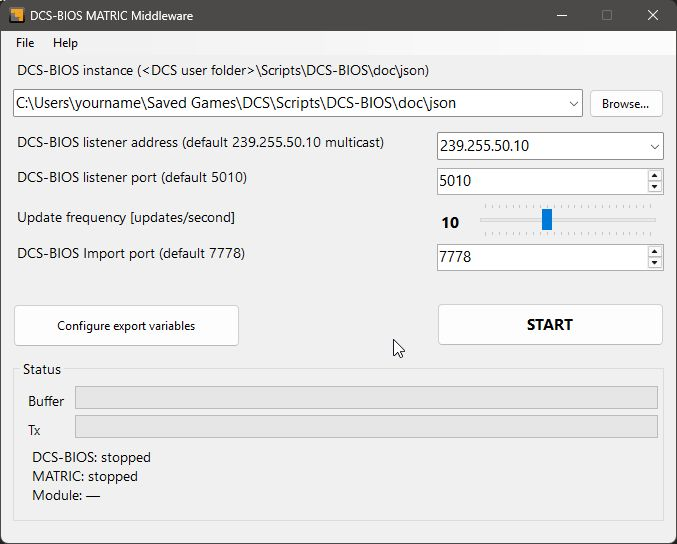
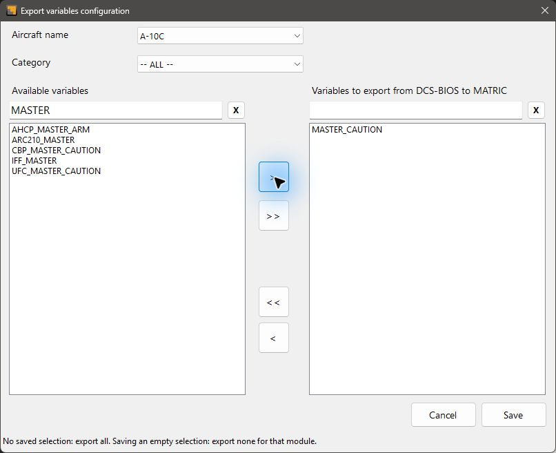

# DCS BIOS MATRIC Middleware

DCS-BIOS MATRIC Middleware (DBMM) connects [DCS World](https://www.digitalcombatsimulator.com/) to [MATRIC](https://matricapp.com). Indicators and displays on your MATRIC deck can follow the cockpit state, and MATRIC controls can send commands to DCS-BIOS.

[Download the latest release](https://github.com/tgudelj/DCS-BIOS-MATRIC-Middleware/releases) · [Read the user manual](DCSMATRICFeeder/DCSMATRICManual.pdf)

## Getting started

1. Install and configure DCS-BIOS, and enable third-party integration in MATRIC Server. Restart MATRIC Server if prompted.
2. Download DBMM, extract it to a folder, and open the app. The standalone download includes the runtime; the framework-dependent download requires the .NET 8 Desktop Runtime for Windows x64.
3. Check the **DCS-BIOS instance** folder. Use **Browse...** to select the `doc\json` folder inside the DCS-BIOS installation you use.
4. Open **Configure export variables**, choose the variables your deck needs, and click **Save**.
5. Click **START**, then load a cockpit in DCS. Check the **DCS-BIOS**, **MATRIC**, and **Module** lines in the Status area.

The default listener address is `239.255.50.10`, the listener port is `5010`, and the import port is `7778`. Leave these unchanged unless your DCS-BIOS setup uses different values.

**START** saves your connection settings and changes to **STOP** while running. Stop the connection before changing the folder, listener address, or ports. The **Update frequency** slider and saved variable selections can be changed while running.

## Connection status

- **DCS-BIOS: receiving** means simulator data is arriving. **Waiting for stream** means DBMM is waiting for data from DCS-BIOS.
- **MATRIC: responding** means MATRIC is available. **Waiting / not responding** means DBMM is waiting for MATRIC Server.
- **Module** shows the detected DCS module. A dash or **waiting for detection** means a module has not yet been identified.
- **Buffer** shows pending updates, and **Tx** shows updates sent. Both connections show **stopped** before you start the middleware.

## Choose variables to export

In **Configure export variables**, use the **Aircraft name** dropdown to choose the module, then select a **Category** or leave **-- ALL --** selected. Search either list, and use **X** to clear a search. Searching changes the visible list and keeps your selections intact.

Use click, Ctrl+Click, or Shift+Click to select variables:

| Button | Action |
| --- | --- |
| `>` | Add selected available variables |
| `>>` | Add all currently shown available variables |
| `<` | Remove selected exported variables |
| `<<` | Clear the entire selection for this module |

**Save** keeps your selections and applies them to a running connection. **Cancel** discards your edits. Choose only the variables your deck needs to keep the workload down while flying.

A module with no saved selection exports all its variables. To export none for a module, clear its selection with `<<` and click **Save**. Separately selected common or metadata variables may still be exported. The reminder at the bottom of the window explains this distinction.

## Share selections and find help

Use **File > Export variables list** to save selections to a file. Use **File > Import variables list** to add selections supplied with a deck or shared by another user. Imports add to your existing selections.

If a configuration warning or connection error appears, choose **Help > Open logs folder** and open the newest log to see the affected file or control. If DCS-BIOS is waiting for a stream, check that DCS and DCS-BIOS are running. If MATRIC is not responding, check that MATRIC Server is running and third-party integration is enabled.

The **Help** menu also contains **Manual**, **Project web**, and **Latest release**.

## Acknowledgements

- [DCS-BIOS-Communicator library by charliefoxtwo](https://github.com/charliefoxtwo/DCS-BIOS-Communicator)
